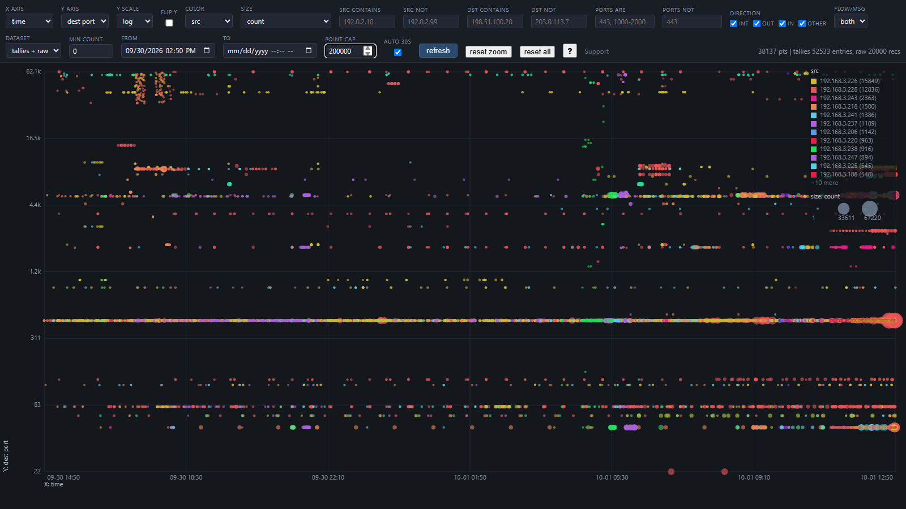
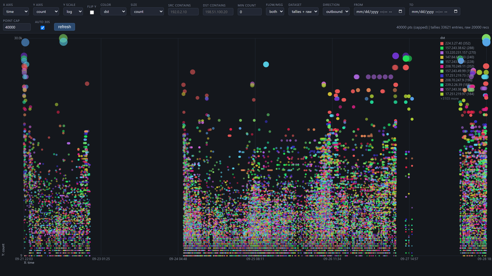
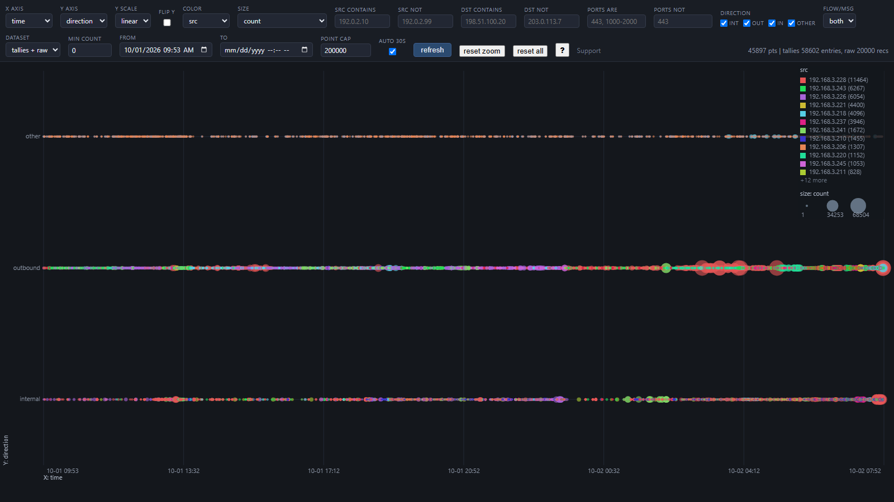
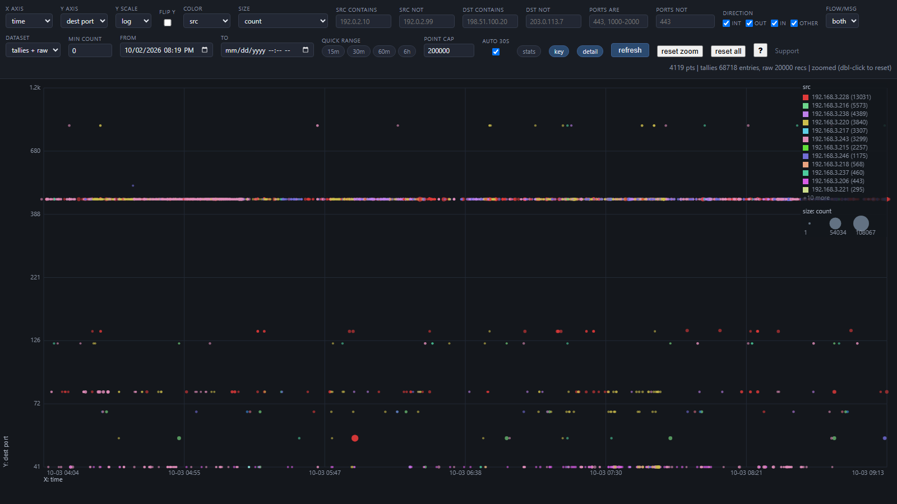
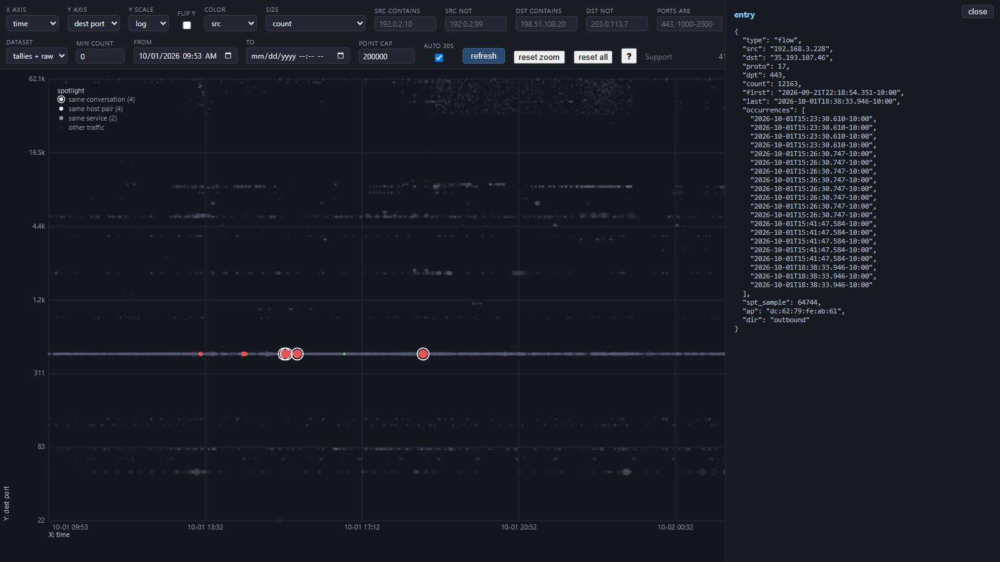

# Omada Logger & Viz

**A zero-dependency Windows syslog receiver, condenser, and real-time
visualizer for TP-Link Omada firewalls and gateways** (ER8411 and friends) -
a free *syslog server for Windows*: if you've been looking for a way to
collect and view Omada firewall logs without a Linux box or a paid product,
this is it.

Point your Omada device's remote logging at this PC and it will:

- **Record every event** to a raw log (UDP 514, RFC 3164/5424-compatible
  payloads, capped at 50 MB with automatic oldest-first trimming)
- **Keep searchable per-event history** in a local SQLite index, including
  DHCP allocation observations, with bounded retention independent of the raw log
- **Condense the flood into tallies** - flows deduplicate to
  `(src, dst, proto, dest port)` counts, repeated alerts fold into message
  templates, each tally keeps first/last seen + the 20 most recent
  occurrence timestamps (own 50 MB cap, survives restarts)
- **Show your traffic in real time** in a browser: interactive
  time-series scatterplot with swappable X/Y axes, color and size
  encodings, log scale, and RFC1918 direction slicing
  (internal / outbound / inbound / other)
- **Heal itself**: boot-start scheduled task (no console window), checkpointed
  crash recovery when the raw log still contains the saved checkpoint, and a
  watchdog that monitors receiver health independently of log traffic

Zero pip installs - pure Python 3 stdlib and vanilla JS.

## Screenshots











*Captured from a live deployment (~40k rendered points, a full day of traffic);
addresses sanitized.*

## Requirements

- Windows 10/11 (or Server) with **Python 3.8+** on PATH (`python.exe`; the
  installer uses `pythonw.exe` when available)
- Tests run with Python 3.14.6. Python 3.8+ is the code compatibility target;
  older versions are not runtime-verified here.
- An Omada gateway/firewall with remote (syslog) logging - UDP 514
- One UAC approval during install

## Install on Windows

Install Python 3.8 or newer from [python.org](https://www.python.org/downloads/windows/)
if it is not already installed. In the installer, enable **Add python.exe to PATH**.
Open a new PowerShell window and check:

```powershell
python --version
```

No third-party Python packages are needed. Git is optional; the app runs
locally after download and needs no internet connection to receive or view
logs.

### Option A: versioned Windows ZIP (no Git required)

Open the [latest GitHub release](https://github.com/Treystu/Omada-Logger-Viz/releases/latest)
and download its versioned `Omada-Logger-Viz-v1.4.0-windows.zip` asset (the
asset name ends in `-windows.zip`).
In File Explorer, right-click the ZIP, choose **Extract All**, and extract
it somewhere stable, such as `$HOME\Tools`. Open PowerShell in the extracted
project folder, or set the location to the example folder below (change
`Tools` if you extracted somewhere else):

```powershell
Set-Location "$HOME\Tools\Omada-Logger-Viz-v1.4.0"
```

Replace `Tools` with the folder where you extracted it if needed. Run it from
the extracted folder, not inside File Explorer's compressed ZIP view. Keep
that folder in place after installation; the scheduled tasks use its path.
The folder must contain `install.ps1` and `omada_syslog.py`.

### Option B: Git clone

If Git is installed, run:

```powershell
git clone https://github.com/Treystu/Omada-Logger-Viz.git
Set-Location Omada-Logger-Viz
```

### Run the installer

From the project folder, run:

```powershell
Set-ExecutionPolicy -Scope Process -ExecutionPolicy Bypass
.\install.ps1
```

Approve the Windows UAC prompt. The installer registers the receiver and
watchdog tasks and adds an inbound UDP 514 firewall rule for
`192.168.0.0/24` on Private and Domain profiles. These are scoped to the
current Windows user except for the firewall rule. The receiver starts
automatically with Windows. The default dashboard behavior is a **logon
shortcut** that starts the hidden dashboard server when you sign in; the
desktop shortcut opens the browser. To keep the dashboard server available
starting at boot, run:

```powershell
.\install.ps1 -VizBoot
```

Re-running the installer reconciles the modes: the default
removes the VizBoot task and restores the logon shortcut; `-VizBoot` removes
the logon shortcut and registers the startup task.

The installer starts the receiver immediately. Then, on the **Omada
Controller** (site management):
**Logs → Setting → Advanced → Remote Logging** — toggle **Enable**, enter
this PC's LAN IP, keep port **514** (UDP default), enable **More Detail Logs**.
Or on the ER8411 web UI directly (standalone, no controller):
**System Tools → System Log → Log Settings** — enable remote logging,
point at this PC's LAN IP, port **514** (UDP). Omada remote logging is
UDP-only; that's all this listens on. If your LAN is not `192.168.0.0/24`,
see [Allowing your LAN](#allowing-your-lan).

Watch it live - double-click the **Omada Viz** desktop shortcut (created by
`install.ps1`), or:

```powershell
.\viz.ps1                   # starts the server if needed, opens the browser
.\viz.ps1 -Stop             # stops it
```

Tail the raw log:

```powershell
Get-Content "$env:LOCALAPPDATA\OmadaSyslog\firewall.log" -Tail 20 -Wait
```

### Allowing your LAN

By default, the receiver accepts syslog only from `192.168.0.0/24`, and the
installer's firewall rule has the same scope. If your gateway and PC use a
different subnet, substitute that CIDR in both places. For example, for
`192.168.1.0/24`, update the firewall rule from an elevated PowerShell window
and reinstall the receiver task with the matching allowlist:

```powershell
Set-NetFirewallRule -DisplayName 'Omada Syslog UDP 514 inbound' -RemoteAddress '192.168.1.0/24'
.\install.ps1 -TaskArgs '--allow 192.168.1.0/24'
```

The dashboard listens on localhost (`http://localhost:8780`) by default.
Its event search and full raw-event views are restricted to the local
computer. You can bind the chart server to the LAN with
`python omada_viz.py --host 0.0.0.0`, but LAN clients receive redacted data
and cannot access the event index or full raw events. Message templates and
parsed details can still contain identifying information. Do not expose the
dashboard to untrusted networks.

## How it works

```
Omada ER8411 ──UDP 514──►  omada_syslog.py (Task Scheduler, boot-start)
                             │
                             ├─► firewall.log      raw lines, 50 MB ring
                             │                     (receive-time + sender + raw payload)
                             ├─► events.sqlite3    searchable per-event history
                             │                     (500 MiB logical target by default)
                             └─► condensed.json    tallies (flows + msg templates)
                                                   50 MB cap, atomic 60 s flushes
                                                   checkpointed restart recovery

python omada_viz.py ──► browser :8780   scatterplot, raw tail, searchable event index
                                        (read-only; sensitive event views are localhost-only)
```

- The receiver splits Omada's multi-record datagrams (CR/LF packed) into
  one log line per record, each re-prefixed with receive time + source IP -
  attribution can't be forged by crafted payloads. NULs stripped.
- The condenser runs **inside** the receiver process: every record folds
  into tallies at ingestion time (failure-armored so raw ingestion is not
  affected). Tallies survive restarts; on startup, the receiver resumes after
  the last saved raw-log checkpoint when that checkpoint is still present.
- Logs are trimmed atomically (temp file + `os.replace`): when the file
  exceeds its cap, the newest ~90% is always kept, oldest lines roll off.
- Nothing is installed machine-wide except the firewall port rule; the
  scheduled task runs as your user (S4U - starts with Windows whether
  you're logged on or not).
- The receiver writes a local heartbeat every 30 seconds while running,
  including when no syslog traffic arrives. The watchdog uses this heartbeat
  to detect a stalled receiver without restarting it during quiet periods.
  Re-run `install.ps1` after updating an existing checkout so its scheduled
  tasks use the current receiver and limited-privilege watchdog.

## Files

| File | Purpose |
|---|---|
| `omada_syslog.py` | The receiver (pure Python 3 stdlib, no pip installs) |
| `install.ps1` | One-time setup: firewall rule + boot task + watchdog (self-elevates) |
| `uninstall.ps1` | Removes tasks + firewall rule (keeps log data) |
| `watchdog.ps1` | Monitors receiver heartbeat and dashboard health (every 5 min) |
| `watchdog-health.ps1` | Read-only heartbeat and restart-cooldown decisions used by the watchdog |
| `omada_condenser.py` | Tallies engine (used by the receiver; `--replay`/`--status` CLI) |
| `condensed_view.py` | Query tool for the condensed tallies |
| `syslog_parser.py` | Offline pretty-printer / filter for the raw log |
| `omada_event_store.py` | Per-event SQLite index, initial raw-log backfill, and retention |
| `omada_viz.py` + `viz.html` | On-demand web UI: interactive scatterplot of tallies + raw tail |
| `viz.ps1` | One-click launcher: starts the viz (if needed) + opens the browser; `-Stop` stops it |
| `test_receiver.py` | Integration tests (safe: high ports + temp files, 30+ checks) |

## Configuration

All settings are command-line flags with sane defaults. To save a receiver
setting in its scheduled task, rerun the installer with the desired flag:

```powershell
.\install.ps1 -TaskArgs '--max-mb 100'
```

The firewall rule is managed separately; changing `--allow` does not change
that rule. See [Allowing your LAN](#allowing-your-lan).

| Flag | Default | Meaning |
|---|---|---|
| `--bind` | `0.0.0.0` | Local address to listen on |
| `--port` | `514` | UDP port |
| `--allow` | `192.168.0.0/24` | Authorized senders (repeatable; IP or CIDR; `0.0.0.0/0` = everyone) |
| `--log-file` | `%LOCALAPPDATA%\OmadaSyslog\firewall.log` | Raw log path |
| `--event-file` | next to `--log-file` (`events.sqlite3` for the default raw filename) | Per-event SQLite history path; pass the same path to receiver and viewer when customized |
| `--event-max-mb` | `500` | Logical event-history target in MiB; excludes reusable SQLite pages, WAL, and cutover snapshot |
| `--max-mb` | `50` | Raw log size cap before trimming |
| `--keep-pct` | `90` | Fraction of cap kept after a trim |
| `--condense-file` | `%LOCALAPPDATA%\OmadaSyslog\condensed.json` | Tallies file |
| `--condense-max-mb` | `50` | Condensed-store size cap (stalest tallies evicted first) |
| `--condense-every` | `60` | Seconds between tally flushes |
| `--condense-max-keys` | `100000` | Hard bound on distinct tally keys in RAM |
| `--occurrences` | `20` | Recent duplicate-occurrence timestamps per tally |
| `--no-condense` | off | Disable condensation (raw log only) |
| `--verbose` | off | Console echo (manual runs / debugging) |

The viewer defaults to `--host 127.0.0.1`, `--port 8780`, and
`--raw-tail 20000`. These flags set the listening address, web port, and
maximum raw-tail rows. `--log-file` selects the raw log to display,
`--condense-file` selects the tally store, and `--event-file` selects the
SQLite history.
The viewer defaults these data paths from the current user's default data
folder; when customizing the receiver's paths, pass matching paths to the
viewer as well. `viz.ps1 -Port 8790` changes the launcher port for a one-off
session.

If your LAN uses a different subnet (e.g. `192.168.1.0/24`), pass
`--allow` accordingly; the installer's firewall rule also needs to match
(see [Allowing your LAN](#allowing-your-lan)).

## Querying and filtering

```powershell
python syslog_parser.py                    # pretty-print all (fac.sev labels)
python syslog_parser.py --sev err          # only err or worse
python syslog_parser.py --text "attack" -n 50

python condensed_view.py                   # top 20 tallies by count
python condensed_view.py --src 192.168.0.10 --dst 1.1.1.1
python condensed_view.py --type msg --stale 7     # events dormant 7+ days
python condensed_view.py --meta                   # store header
python omada_condenser.py --status                # summary + top tallies
python omada_condenser.py --replay                # manual fold of raw backlog
```

Stop the receiver before `--replay`: a running receiver holds tallies in
memory and overwrites the file on its next flush.

## Visualizing (web UI)

On-demand, read-only, localhost by default, zero dependencies:

```powershell
python omada_viz.py          # then open http://localhost:8780
```

The event index uses the receiver's `--event-file` path. If you customize
the receiver's database location, pass that same path to the viewer:

```powershell
python omada_syslog.py --event-file "D:\Omada\events.sqlite3"
python omada_viz.py --event-file "D:\Omada\events.sqlite3"
```

The receiver defaults to a **500 MiB (524,288,000 byte) logical retention
target**. It evicts the oldest indexed records when that target is exceeded,
then aims below the limit to leave room for growth. This is not a disk-file
limit: deleted SQLite pages are reusable but are not compacted, and the WAL
and temporary cutover snapshot add physical disk usage outside the target.
The snapshot is used while importing the old raw log and is removed after
backfill completes. The default raw log still has its separate 50 MB rolling
cap.

When the receiver first opens an event store, it seals and copies the raw log
that exists at that moment, then imports that snapshot in small batches while
new records continue to be indexed. During this initial backfill, the index
reports `backfilling` and search results may be partial. The snapshot only
contains raw lines still retained at cutover; records already trimmed from
the raw log are not recoverable by this backfill. The event index is the
searchable per-event record source after cutover; `condensed.json` remains a
separate aggregate view, and `firewall.log` remains a rolling compatibility
log. Event-store write gaps and pending recovery batches appear in index
status. When SQLite is temporarily unavailable, the receiver stages event
batches in a separate recovery journal capped at 64 MiB. If both SQLite and
that journal cannot accept a batch, the receiver still writes the raw log,
but that batch is missing from the searchable index; status records the
missed live rows and pending recovery batches. Records evicted from the event
index cannot be restored from it; a copy may remain in the raw log temporarily,
until that log trims it.

The **DHCP associations** view lists observed Omada allocation messages,
including their timestamp, sender, client MAC, allocated IP, and original
event. It does not show current leases: a logged allocation may be a renewal
or repeated observation, and does not establish that a lease is still active.
The index also includes other activity, unknown, and malformed records. A
record can remain searchable even when its format is unknown or its fields
cannot be parsed; those rows are labeled with their parse status instead of
being omitted.

Or just double-click the desktop shortcut / run `.\viz.ps1` (starts the
server headless if needed, then opens the page; `.\viz.ps1 -Stop` stops it).

Prefer always-on? `.\install.ps1 -VizBoot` registers a boot task so the
dashboard is permanently available at http://localhost:8780 - the idle
server costs a few MB of RAM; the only real work is building the data
payload when a browser asks for it.

Interactive time-series scatterplot of the condensed tallies (long-term)
plus the raw-log tail (fine-grained; last 20k records, `--raw-tail` to
change):

- **X / Y axes** (each swappable): time, first seen, last seen, count, src,
  dst, dest port, proto, severity, flow/msg, dataset, direction
- **Y scale**: linear or log (numeric axes), plus a **flip Y** toggle to
  reverse the axis direction
- **Brush zoom**: drag a rectangle on the chart to zoom into any region
  (dense clusters become readable); double-click, Esc, or the "reset zoom"
  button zooms back out. Zoom holds across auto-refreshes. Thin horizontal
  or vertical bands zoom just the axis they span.
- **Pattern spotlight**: click any dot to grey the noise and pop its related
  traffic — same conversation (white-ringed), same host pair, same service
  — making patterns visible at a glance. Esc or an empty click clears it.
- **Color-key drilldown**: click a legend entry (an IP, a port, a severity)
  to filter the entire view to that value. Click it again to remove it.
- **Scoped stats panel**: unique counts (sources, destinations, ports,
  flows, protocols), per-entry totals, and direction breakdown with
  proportional bars — all reflecting whatever you've spotlighted, zoomed
  into, or drilled down to.
- **Color / point size**: src, dst, port, proto, severity, dataset,
  direction, or count (blue-to-red gradient, log-scaled for even spread).
  Size also offers **per-group aggregates** — e.g. "distinct ports per
  group" sizes each dot by how many different services its device talks to
  (grouping follows the color variable, then the categorical axis). Records
  and flows per group act as traffic-quantity proxies — Omada's remote log
  doesn't include byte or packet totals.
- **Precise filtering**: src/dst smart IP matching (single IPs, ranges
  `192.168.0.100-200`, shorthand lists `192.168.0.1,2,3,6-10,12`, CIDR
  `10.0.0.0/8`), dest-port include/exclude lists with ranges, RFC1918
  direction checkboxes in any combination, flow vs msg, dataset, min count,
  time range + quick-range buttons (15m/30m/60m/6h), point cap — plus a
  one-click "reset all".
- **32-color palette** with re-rank on filter changes — the top 12 visible
  categories always get distinct, evenly-spread colors
- **Legend + drawer visibility toggles**: persistent "key" and "detail"
  buttons hide/show each panel independently
- **Built-in help**: hover any control for a one-line explanation, or hit
  the "?" button for the full how-to guide.
- Hover for a summary; click a point for the full tally entry.
- Auto-refreshes every 30 s without disturbing the view (colors and zoom
  stay stable; time windows slide). Ctrl+C (or close the window) to stop.
  `--host 0.0.0.0` if you ever want to view it from the LAN.

Defaults open as X = time, Y = dest port, color = src, size = count -
"who's been talking to which services, when, and how much".

The UI also has a **messages** view that groups condensed message counts by
their normalized template and shows severity separately. Clicking a bubble
opens the available aggregate details. It uses condensed aggregates when
present and falls back to the retained raw tail only when no condensed
message aggregates are available, so the same events are not counted twice.
The events browser remains available for full retained raw lines on localhost.
The **DHCP / event index** view searches the per-event store by activity,
sender, IP, MAC, text, and time, with timestamp sorting and stable older-page
navigation. Its status reports unavailable, backfilling, ready, or degraded
coverage, along with legacy-import progress, evictions, and known write gaps;
an unavailable or backfilling index is not presented as an empty history.
The viewer opens the event database read-only; only the receiver writes to
it. Both the retained raw-events browser and searchable index require a
loopback connection and a localhost/loopback `Host` header (or the exact
non-wildcard host configured with `--host`). `/api/data` remains usable from
LAN clients with its existing message-body redaction; a local browser request
with an unrelated `Host` header is rejected to prevent DNS rebinding.

When the visualization is served to a non-localhost client (for example with
`--host 0.0.0.0`), `/api/data` removes original message bodies, condensed
message samples, raw message labels, and RFC 5424 structured-data text.
Condensed message templates and parsed flow/header metadata remain available
to the chart; templates may still contain identifying details and are not
anonymized. The full raw events browser remains localhost-only.

## Watchdog (auto-restart)

A scheduled task (`Omada Syslog Watchdog`, every 5 min, limited to the current
user) checks the receiver heartbeat, refreshed every 30 seconds even when the
network is quiet. On older installations that have never written a heartbeat,
missing-heartbeat checks stay disabled until the new installer arms them or a
heartbeat has been seen. The receiver publishes its first heartbeat after binding
the UDP socket and opening the raw log, then refreshes it during long recovery
scans and every 30 seconds while running. If it is stale for 10+ minutes, the
watchdog waits a 90 s grace period, re-checks, then restarts the receiver task.
Stale-heartbeat restarts are limited to once per 30 min. On older installs
that have previously armed monitoring, a missing heartbeat is treated as
stale; failed restarts can be retried after the 30 min cooldown. Receiver
restarts fold any un-tallied raw lines on startup when recovery can be verified.

## Recovery and diagnostics

Each condensed-store flush saves a hash and byte offset for the last raw line
included in the tallies. After a restart, the receiver verifies that exact
line and folds later raw-log records. Older stores only have a hash; if that
hash appears on multiple lines, the checkpoint is ambiguous and recovery stops
instead of guessing. If trimming, rotation, or truncation removes or shifts the
saved checkpoint, automatic recovery also stops. In either case the receiver
keeps accepting and writing raw logs but disables condensation for that run,
so it does not save a newer checkpoint past records it could not recover.

The receiver writes a small JSON diagnostic to
`%LOCALAPPDATA%\OmadaSyslog\recovery-status.json` after a recovery failure.
It contains only a status, timestamp, and reason code (no log contents); it
remains until a later startup completes recovery successfully. The dashboard
surfaces this status. To retry manually, stop the receiver and run
`python omada_condenser.py --replay --force`; forcing a full replay can
double-count lines already represented in the condensed store. Raw records
removed by log trimming cannot be recovered from that file.

## Tests

```powershell
python test_receiver.py
python test_watchdog_health.py
powershell -NoProfile -File test_watchdog_health.ps1
```

The receiver suite runs the receiver + condenser + viz through 30+ integration checks on a
high port with temp files - ingestion, allowlist, multi-record splitting,
trimming, dedup, restart persistence, eviction, failure armor, replay
markers, and the viz API.
The watchdog suites exercise heartbeat scheduling, catch-up progress,
legacy-install, startup-grace, and cooldown decisions using temporary files;
they do not install or start scheduled tasks.

## Upgrade, backup, and restore

Receiver and dashboard code live in the project folder; collected data lives
separately in `%LOCALAPPDATA%\OmadaSyslog`. To upgrade a Git checkout, update
the source and rerun the installer so scheduled tasks point at the current
files:

```powershell
git pull --ff-only
.\install.ps1
```

For a ZIP install, extract the new source ZIP and replace the files in the
existing project folder with its contents, then run `install.ps1` from that
folder. The installer updates the scheduled tasks; it leaves collected logs
and history in place.

```powershell
.\install.ps1
```

To make a consistent data backup, stop the watchdog and receiver tasks, then
stop the dashboard if it is running. Copy the whole data folder, including
SQLite sidecar files if present:

```powershell
Stop-ScheduledTask -TaskName 'Omada Syslog Watchdog' -ErrorAction SilentlyContinue
Stop-ScheduledTask -TaskName 'Omada Syslog Receiver' -ErrorAction SilentlyContinue
Disable-ScheduledTask -TaskName 'Omada Syslog Watchdog' -ErrorAction SilentlyContinue
Disable-ScheduledTask -TaskName 'Omada Syslog Receiver' -ErrorAction SilentlyContinue
.\viz.ps1 -Stop
$backup = Join-Path $HOME 'Documents\OmadaSyslog-backup'
Copy-Item "$env:LOCALAPPDATA\OmadaSyslog" $backup -Recurse -Force
Enable-ScheduledTask -TaskName 'Omada Syslog Watchdog' -ErrorAction SilentlyContinue
Enable-ScheduledTask -TaskName 'Omada Syslog Receiver' -ErrorAction SilentlyContinue
Start-ScheduledTask -TaskName 'Omada Syslog Receiver' -ErrorAction SilentlyContinue
Start-ScheduledTask -TaskName 'Omada Syslog Watchdog' -ErrorAction SilentlyContinue
```

To restore, stop the watchdog and receiver, then copy the backup's contents
back to `%LOCALAPPDATA%\OmadaSyslog` and rerun `install.ps1` to register and
start the current tasks. Use the same Windows account as the original data
folder. Set `$backup` to the actual backup folder path:

```powershell
Disable-ScheduledTask -TaskName 'Omada Syslog Watchdog' -ErrorAction SilentlyContinue
Disable-ScheduledTask -TaskName 'Omada Syslog Receiver' -ErrorAction SilentlyContinue
Stop-ScheduledTask -TaskName 'Omada Syslog Watchdog' -ErrorAction SilentlyContinue
Stop-ScheduledTask -TaskName 'Omada Syslog Receiver' -ErrorAction SilentlyContinue
New-Item -ItemType Directory -Force "$env:LOCALAPPDATA\OmadaSyslog" | Out-Null
$backup = Join-Path $HOME 'Documents\OmadaSyslog-backup'
Get-ChildItem -LiteralPath $backup -Force | Copy-Item -Destination "$env:LOCALAPPDATA\OmadaSyslog" -Recurse -Force
.\install.ps1
```

## Uninstall

```powershell
.\uninstall.ps1
```

Removes the receiver, watchdog, and optional VizBoot tasks, the desktop and
startup shortcuts, and the firewall rule. It keeps the project files and
collected data at `%LOCALAPPDATA%\OmadaSyslog`. To remove the collected data
as well, first make sure you have any backup you need, then delete that
folder in File Explorer. Delete the project folder separately if you want to
remove the application files too.

## Troubleshooting

- **No data arriving?** Check the Omada Controller's **Logs → Setting →
  Advanced → Remote Logging** (or the ER8411's direct web UI) - confirm the
  target is this PC's *current* LAN IP (`ipconfig`) - a DHCP lease change
  silently orphans the stream. A DHCP reservation fixes it for good. Also
  confirm the receiver task is Running (`Get-ScheduledTask -TaskName 'Omada Syslog Receiver'`).
- **Port 514 already bound?** Another syslog service may have claimed it.
  The receiver refuses to share the port (deliberate); stop the other one.
- **Viz won't start?** The default port is 8780 - if taken, use
  `--port 8790`. The server refuses to share ports too.
- **Receiver stops responding after sleep?** The watchdog checks its heartbeat,
  then restarts the receiver after the stale threshold and grace period; give
  the machine's network a moment to re-associate.
- **Trim not shrinking the log?** A viewer (Excel, `Get-Content -Wait`)
  holding the log open pauses trimming; close it and the next cycle trims.

## Notes & caveats

- **Trim = data loss by design**: anything past the 50 MB window is gone.
  Adjust `--max-mb` if you need a longer window.
- Don't keep the log open in Excel or other locking apps while the receiver
  runs - a locked file pauses trimming (resumes when released; the file may
  temporarily exceed the cap).
- The installer adds a Windows Firewall rule scoped to inbound UDP 514 from
  192.168.0.0/24 (Private/Domain profiles). If you change `--allow` to a
  different subnet, adjust the firewall rule to match.
- Local tail: `Get-Content -Wait` holds a lock and can block trims while it
  runs; close it when finished.
- Everything is scoped to the current user (task identity and log data). The
  one machine-wide piece is the firewall port rule, which only admits
  inbound UDP 514 from the LAN subnet.

## Support

This is free and always will be. If it saved you a syslog-server license or a
Linux VM and you want to chip in, contributions go directly to the author.

[PayPal](https://www.paypal.me/LBallek) &middot; [Venmo — @lucas-ballek](https://venmo.com/u/lucas-ballek) &middot; [Cash App — $luball](https://cash.app/$luball)

Contributions are voluntary gifts to an individual, not payment for a
service, and are not tax-deductible. They buy nothing: no priority support,
no warranties, no promises about future features.

## License

[MIT](LICENSE) - use it, fork it, ship it.
